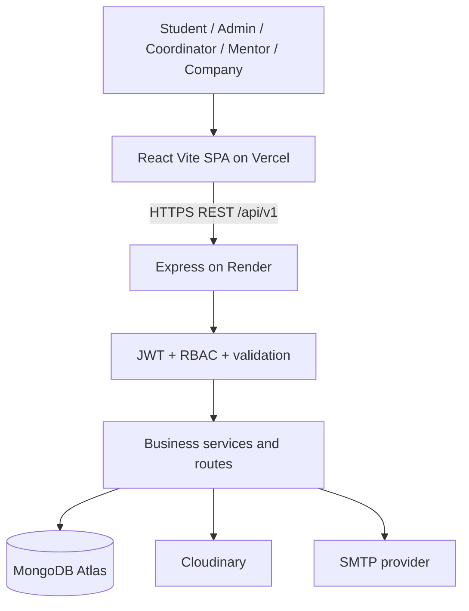

# InternSphere — System Architecture

## Context and scope
A single React/Vite client communicates over HTTPS with a Node/Express REST API. Express verifies JWTs, authorizes role and record ownership, validates inputs with Zod, and accesses MongoDB through Mongoose. Cloudinary stores uploaded file objects; MongoDB stores document metadata. Optional SMTP notifications are sent from the server. No direct client-to-database access is allowed.

## Trust boundaries
- Public APIs expose only public internship/company fields. Private endpoints must enforce role and record ownership on the server.
- Refresh tokens are cookie based; access tokens are in-memory client state. Never log JWTs or passwords.
- `institutionId` is intended to partition institutional records. This implementation is **not verified** for multiple institutions; see `phase7-test-report.md`.
- The current deployment is a candidate configuration, not a production security certification.

## Core lifecycle
`applied → under_review → shortlisted → selected` or `rejected`; withdrawal may be allowed before terminal states. A selected student receives an active mentor allocation, submits weekly reports, receives mentor review, and obtains mentor/company evaluations. Completion eligibility is checked on the server; printable certificate access is protected.
