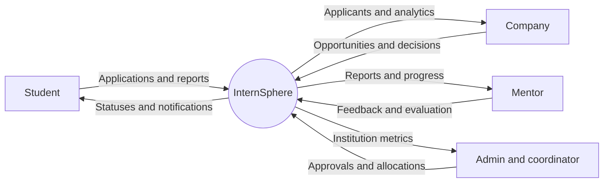
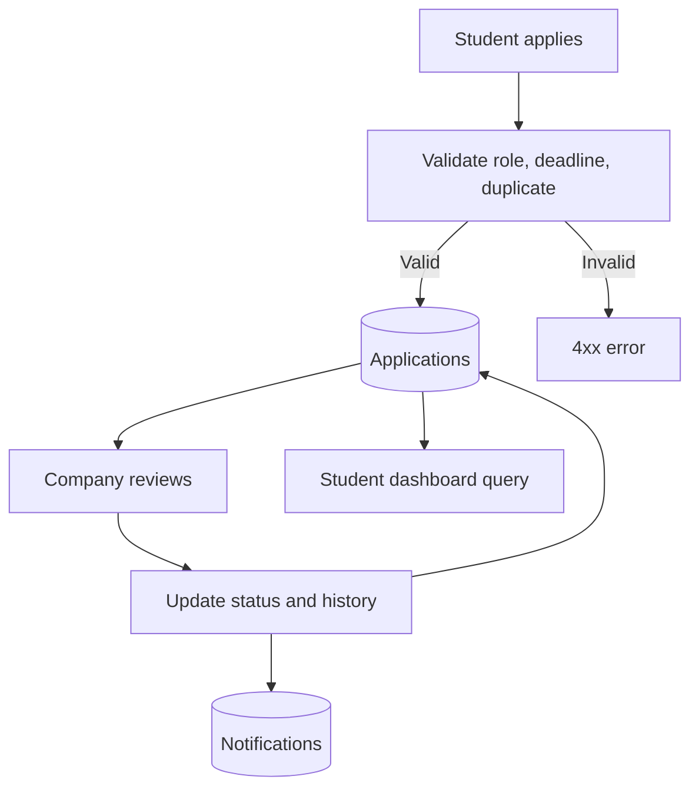

# Data Flow Diagrams

## Level 0 — Context

## Level 1 — Application lifecycle

The diagrams represent logical flows. The current system uses REST requests and database reads; it does not implement WebSockets.
