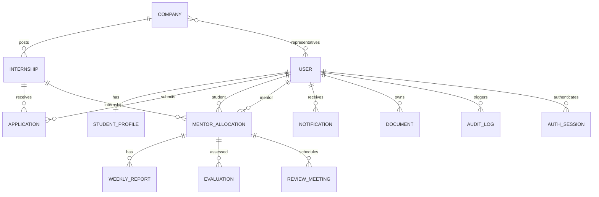

# Database Design and ER Diagram

The database is MongoDB with Mongoose ObjectId references. Primary domain collections are User, StudentProfile, Company, Internship, Application, MentorAllocation, WeeklyReport, Evaluation, Notification, Document, ReviewMeeting and AuditLog. Supporting collections include EvaluationConfig and AuthSession.

## Integrity rules
- Unique normalized account email; unique student/internship application pair; unique allocation/week report pair.
- Mongoose references do not provide database-level foreign-key enforcement; route/service checks must validate linked entities and institution ownership.
- Audit history should be append-only in normal application operation.
- For real multi-tenant deployment, backfill institution IDs on legacy allocations and review **all** read and write paths; currently incomplete.
- Store Cloudinary object IDs, not binary document contents, in MongoDB.

See `server/src/models/index.js` for the authoritative schema fields, required properties, indexes and defaults. This ERD is a logical overview, not a replacement for the implementation.
