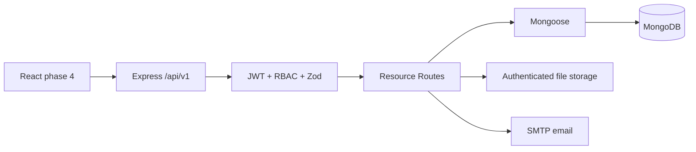

# Phase 3 Architecture

## Database model relationships
User -> StudentProfile (1:0..1), User -> Application (1:many), Company -> Internship (1:many), Internship -> Application (1:many), Student+Internship -> MentorAllocation, MentorAllocation -> WeeklyReport/Evaluation/ReviewMeeting, User -> Notification/Document/AuditLog. `AuthSession` and `EvaluationConfig` are additional support collections. All have timestamps; major query and uniqueness indexes are in `server/src/models/index.js`.

## Trust boundaries
Do not trust `studentId`, `evaluatorId`, `createdBy`, or `ownerId` supplied by the browser. They are derived from the verified JWT. Resource lookups must additionally validate ownership, company affiliation or mentor allocation. This skeleton requires further multi-institution partitioning before a real multi-college rollout.
