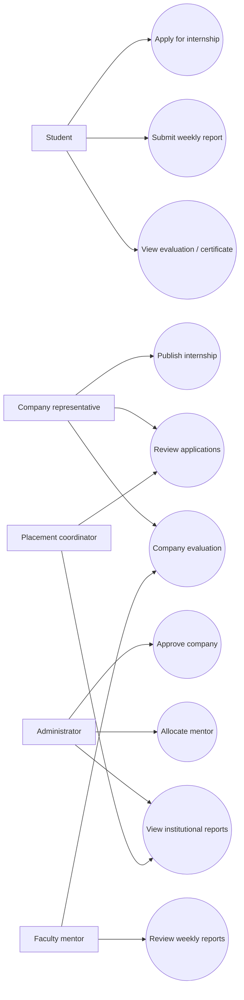

# Use Cases

## Representative use case: Apply
**Actor:** student. **Preconditions:** authenticated student profile; open internship; deadline not passed. **Action:** POST `/api/v1/applications` with internship ID. **Expected result:** application created with `applied` status and visible in student history. **Failure cases:** duplicate application, invalid ID, expired deadline, missing profile, unauthorized role.

## Representative use case: Mentor review
**Actor:** assigned faculty mentor. **Preconditions:** active allocation, report submitted. **Action:** approve or request revision. **Expected result:** updated report state; student can resubmit revisions for the same week. **Failure cases:** wrong mentor, already finalized report, invalid status.
